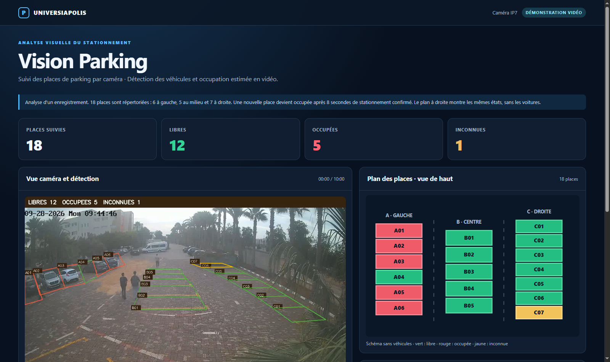
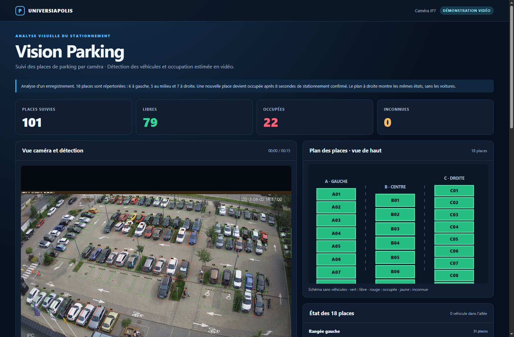
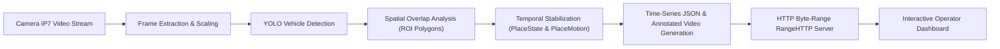

# Vision Parking — Intelligent Parking Monitoring System

> **Video-based parking-space monitoring and vehicle detection developed within the Universiapolis Fab Lab framework.**

[](https://www.python.org/)
[](https://opencv.org/)
[](https://ultralytics.com/)
[](https://universiapolis.ma/)

---

## 🏛️ Institutional Context & Project Origin

**Vision Parking** is an institutional computer vision project requested by **Universiapolis — Université Internationale d'Agadir (UIA)** and assigned through the **Universiapolis Fab Lab** service. 

Developed as part of the Fab Lab engineering team (contributor: **Zinedine Tlemsani Benhattal**), the goal was to investigate how the university's existing IP video surveillance infrastructure could be repurposed into an automated, non-intrusive smart parking occupancy monitoring system without deploying costly physical in-ground magnetic sensors or requiring new road repainting.

---

## 📸 Dashboards & Live Monitoring Previews

The system processes real-world surveillance video streams, estimates spot occupancy using calibrated polygonal ROIs, and renders real-time interactive web dashboards for facility operators.

### 1. Universiapolis Campus Parking Dashboard (Camera IP7 — 18 Spaces)
> Evaluated on the 10-minute continuous stream from campus camera IP7. Displays real-time occupancy counts, timeline synchronization, and dynamic 2D top-down parking layout.



---

### 2. Outdoor High-Density CCTV Parking Dashboard (101 Spaces)
> Evaluated on a 4K surveillance camera stream across 101 outdoor parking spots (PKLot dataset benchmark). Compensates for wide-angle perspective distortion across 3 extensive zones.



---

## ✨ Implemented Features

- **Non-Intrusive Edge Video Analytics**: Utilizes existing overhead IP camera streams (evaluated on a 10-minute continuous stream from camera IP7, 09:44:46 – 09:54:46).
- **YOLO Vehicle Detection**: Detects vehicles (cars, vans, trucks, buses) per frame with configurable confidence thresholds, bounding-box tracking, and coordinate transformation.
- **Polygonal Region-of-Interest (ROI) Mapping**: Monitors 18 designated parking spots divided into 3 distinct rows:
  - **Zone A (A01 – A06)**: 6 spots on the left row.
  - **Zone B (B01 – B05)**: 5 spots in the center row.
  - **Zone C (C01 – C07)**: 7 spots on the right row.
- **Temporal Hysteresis & State Machine**:
  - Four distinct states: `Libre` (Available - Green), `Occupée` (Occupied - Red), `Inconnue` (Unknown/Edge - Yellow), and `En circulation` (In transit - Blue indicator).
  - Spatial motion filtering (`PlaceMotion`): evaluates whether a vehicle has remained stationary within an 8-pixel tolerance window over 1.5 seconds.
  - Temporal confirmation delay: 8-second confirmation window before transitioning states, eliminating false positives during parking maneuvers (e.g., tested on spot B02 maneuver between 03:17 and 03:49).
- **Interactive Multi-Panel Web Dashboard**:
  - Synchronized video player with HTTP 206 Byte-Range streaming for instant timeline scrubbing.
  - Real-time statistics: Total spaces (18) = Available + Occupied + Unknown.
  - Synchronized 2D top-down parking layout (`plan_18_places.jpg`) mirroring exact live states.
  - Camera-synchronized arrival timestamps (e.g., A04 parked at 09:46:26, B02 parked at 09:48:28).
- **Interactive Visual Calibration Lab (`manual_lab.py`)**:
  - Built-in OpenCV GUI application enabling operators to visually inspect YOLO detections, adjust polygon vertices, zoom into regions of interest, and export updated ROI geometries.
- **Directional Passage Tripwire Counter (`PassageCounter`)**:
  - Virtual tripwire algorithm using vector cross-product orientation (`line_side`) to detect and count entries and exits with cooldown suppression.

---

## 🏗️ System Architecture



---

## 🛠️ Technologies & Stack

| Component | Technology | Description |
|---|---|---|
| **Programming Language** | Python 3.13 | Core backend, analysis pipeline, and servers |
| **Computer Vision** | OpenCV (`cv2`) | Video reading, drawing annotations, GUI calibration workshop |
| **Object Detection** | Ultralytics YOLO (`yolo26n.pt`) | Vehicle detection and bounding box inference |
| **Mathematics & Geometry** | NumPy | Ray casting polygon tests, matrix scaling, coordinate calculations |
| **Image Processing** | Pillow (`PIL`) | Top-down 2D diagram generation and rendering |
| **Web Dashboard** | HTML5, CSS3, JavaScript | Interactive operator frontend with synchronized controls |
| **Streaming Server** | Python `http.server` | Custom `RangeHTTPRequestHandler` supporting HTTP 206 Partial Content |
| **Cloud Demo** | Flask & Vercel Serverless | Authenticated cloud demonstration architecture |

---

## 📹 Evaluated Video Datasets & Camera Streams

The project was evaluated and tested across two distinct real-world video streams to validate detection accuracy, perspective invariance, and system scalability:

| Parameter / Feature | Stream 1: Universiapolis Campus IP7 | Stream 2: Outdoor CCTV Parking (PKLot) |
|---|---|---|
| **Video Source File** | `01_VIDEO_SOURCE/video_ip7_10_minutes.mp4` | `01_VIDEO_SOURCE/parking_cctv_softserve.mp4` |
| **Perspective Angle** | Elevated campus diagonal view | High elevated outdoor commercial CCTV view |
| **Resolution & FPS** | 1280 × 960 (4:3) @ 25 FPS | 3840 × 2160 (4K UHD 16:9) @ 30 FPS |
| **Duration** | 10 minutes (15,000 frames) | 15 seconds evaluation sequence |
| **Monitored Capacity** | **18 spots** (Zone A: 6, Zone B: 5, Zone C: 7) | **101 spots** (Zone A: 31, Zone B: 39, Zone C: 31) |
| **Ground Truth Geometry** | `02_POLYGONES/places_18.json` | `02_POLYGONES/places_cctv_101.json` |
| **Observed Occupancy** | 5 Occupied, 12 Free, 1 Unknown | 22 Occupied, 79 Free, 0 Unknown |
| **Detection Challenges** | Vehicle parking maneuvers (B02), edge occlusions (C07), arrival timestamps | Wide-angle perspective distortion across distant rows, dense multi-vehicle clustering |
| **Dashboard URL** | `http://127.0.0.1:8001/` | `http://127.0.0.1:8002/` |
| **One-Click Launcher** | `OUVRIR_TABLEAU_DE_BORD.cmd` | `OUVRIR_NOUVEAU_PARKING.cmd` |

---

## 📂 Project Structure

```text
PROJET_PARKING_IP7/
├── 01_VIDEO_SOURCE/             # Video streams under evaluation
│   ├── video_ip7_10_minutes.mp4 # Universiapolis IP7 10-min recording (18 spaces)
│   └── parking_cctv_softserve.mp4 # High-density outdoor 4K CCTV recording (101 spaces)
├── 02_POLYGONES/                # Calibrated coordinates & ROI geometries
│   ├── places_18.json           # Universiapolis 18 parking spots
│   └── places_cctv_101.json     # Outdoor CCTV 101 parking spots
├── 03_CODE_PYTHON/              # Python source code package (parking_demo)
│   └── parking_demo/
│       ├── __init__.py
│       ├── __main__.py          # Unified CLI entry point (annotate, analyze, serve)
│       ├── analyze.py           # YOLO inference, overlap logic, and output generator
│       ├── annotate.py          # Polygon annotation tool
│       ├── core.py              # Geometric tests, PlaceState, PlaceMotion, PassageCounter
│       ├── manual_lab.py        # Interactive OpenCV visual calibration GUI
│       ├── render_plan.py       # 2D top-down diagram renderer
│       └── server.py            # HTTP server with byte-range support
├── 04_INTERFACE_WEB/            # Dashboard HTML/CSS/JS template
├── 05_RESULTATS_DEMO/           # Evaluation results (Universiapolis IP7 - 18 spots)
│   ├── dashboard_ip7_screenshot.png # High-resolution dashboard screenshot
│   ├── apercu.jpg               # Camera detection overlay screenshot
│   ├── index.html               # Interactive web dashboard
│   ├── plan_18_places.jpg       # Top-down parking diagram
│   ├── resultats.json           # Time-indexed occupancy database
│   └── video_annotee.mp4        # Annotated demonstration video
├── 06_DOCUMENTS/                # Technical documentation, synthesis PDF, and presentation notes
├── 07_MODELE_YOLO/              # Pretrained YOLO weights (yolo26n.pt)
├── 08_RESULTATS_NOUVELLE_VIDEO/ # Evaluation results (Outdoor CCTV - 101 spots)
│   ├── dashboard_cctv_101_screenshot.png # High-resolution dashboard screenshot
│   ├── apercu.jpg               # Camera detection overlay screenshot
│   ├── index.html               # Interactive web dashboard
│   ├── plan_18_places.jpg       # Top-down diagram / detection view
│   ├── resultats.json           # Occupancy database (79 free, 22 occupied)
│   └── video_annotee.mp4        # Annotated demonstration video
├── 09_HEBERGEMENT_DEMO/         # Flask web demo architecture for cloud hosting (Vercel)
├── INSTALLER_OUTILS.cmd         # One-click environment installation script
├── OUVRIR_TABLEAU_DE_BORD.cmd   # One-click local dashboard launcher (port 8001)
├── OUVRIR_NOUVEAU_PARKING.cmd   # One-click new video dashboard launcher (port 8002)
├── OUVRIR_ATELIER.cmd           # One-click visual calibration workshop launcher
├── OUVRIR_DEMO_PROTEGEE.cmd     # One-click authenticated demo launcher (port 8010)
├── requirements.txt             # Python dependencies
└── README.md                    # Project documentation
```

---

## 🚀 Getting Started

### 1. Prerequisites
- **Python 3.13** installed on your system.
- Git.

### 2. Installation
Clone the repository and set up the virtual environment:

```bash
git clone https://github.com/Mohammed-aichour/vision-parking-universiapolis.git
cd vision-parking-universiapolis

# Create and activate virtual environment
python -m venv .venv
# On Windows:
.venv\Scripts\activate
# On Linux/macOS:
source .venv/bin/activate

# Install dependencies
pip install --upgrade pip
pip install -r requirements.txt
```

*(Alternatively on Windows, simply double-click `INSTALLER_OUTILS.cmd`)*

---

## 💻 Running the Application

### Option A: Launch the Web Dashboard
To view the pre-computed demonstration with synchronized video and 2D occupancy mapping:

```bash
# Windows shortcut
Double-click OUVRIR_TABLEAU_DE_BORD.cmd

# Or via command line:
set PYTHONPATH=03_CODE_PYTHON
python -m parking_demo serve --dir 05_RESULTATS_DEMO --port 8001
```
Open your browser at `http://127.0.0.1:8001/`.

---

### Option B: Launch the New 101-Space Parking Dashboard
To view the newly analyzed outdoor CCTV demonstration (101 spots across Zones A, B, and C):

```bash
# Windows shortcut
Double-click OUVRIR_NOUVEAU_PARKING.cmd

# Or via command line:
set PYTHONPATH=03_CODE_PYTHON
python -m parking_demo serve --dir 08_RESULTATS_NOUVELLE_VIDEO --port 8002
```
Open your browser at `http://127.0.0.1:8002/`.

---

### Option C: Launch the Interactive Calibration Workshop
To adjust polygon coordinates or test YOLO detections visually:

```bash
# Windows shortcut
Double-click OUVRIR_ATELIER.cmd

# Or via command line:
set PYTHONPATH=03_CODE_PYTHON
python -m parking_demo.manual_lab
```

---

### Option D: Re-run Video Analysis
To analyze a new or modified video stream using the YOLO model and polygon definitions:

```bash
set PYTHONPATH=03_CODE_PYTHON
python -m parking_demo analyze --video "01_VIDEO_SOURCE/video_ip7_10_minutes.mp4" --zones "02_POLYGONES/places_18.json" --out-dir "05_RESULTATS_DEMO" --model "07_MODELE_YOLO/yolo26n.pt" --confidence 0.25 --stable-sec 1.5
```

---

## 🔍 Validation & Field Test Results

| Metric / Scenario | Observation in Evaluation Dataset |
|---|---|
| **Monitored Spaces** | 18 spaces total across 3 rows |
| **Maneuver Tracking (B02)** | Vehicle starts parking maneuver at ~03:17; space remains green during movement, stabilizes for 2s, and is confirmed occupied (Red) at 03:49.5 (8-second stabilization rule). |
| **Arrival Detection (A04)** | Arrival detected at 09:46:26 (confirmed at 09:46:34). |
| **Initial State Handling** | Existing parked vehicles without arrival footage (A01–A03, A05–A06) correctly initialized as occupied without fabricated timestamps. |
| **Edge Conditions** | Space C07 (near bins, occluded angle) flagged as `Inconnue` (Yellow) to avoid unverified assumptions. |

---

## 🔮 Limitations & Future Enhancements

- **Direct RTSP Streaming**: Connect directly to NVR streams via RTSP for 24/7 continuous real-time monitoring rather than pre-recorded evaluation batches.
- **Dedicated Access Camera**: Integrate a dedicated entrance/exit gate camera for accurate vehicle counting, complementing the overhead parking view.
- **Multi-Camera Fusion**: Combine views from adjacent cameras to reduce perspective occlusion caused by large vehicles or roadside trees.
- **Night & Adverse Weather Optimization**: Fine-tune detection parameters for low-light conditions and rain reflections.

---

## 👥 Acknowledgments & Institutional Credits

- **Universiapolis — Université Internationale d'Agadir (UIA)**: Institutional project initiator and infrastructure provider.
- **Universiapolis Fab Lab**: Engineering project framework and technical team.
- **Contributor**: Zinedine Tlemsani Benhattal (*Génie Informatique, École Polytechnique d’Agadir — Universiapolis Fab Lab Team Member*).
